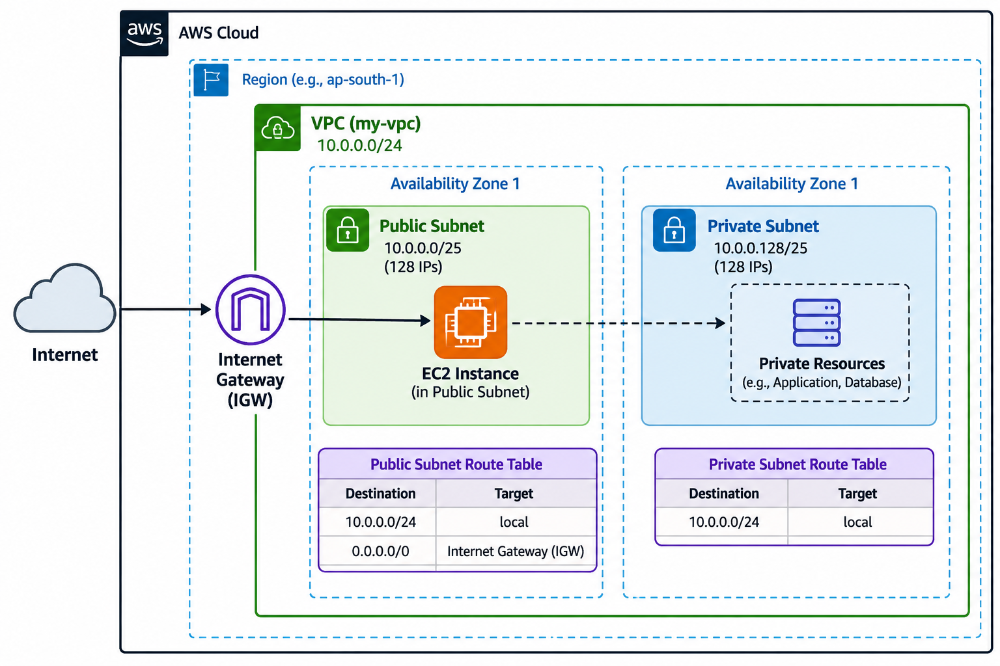
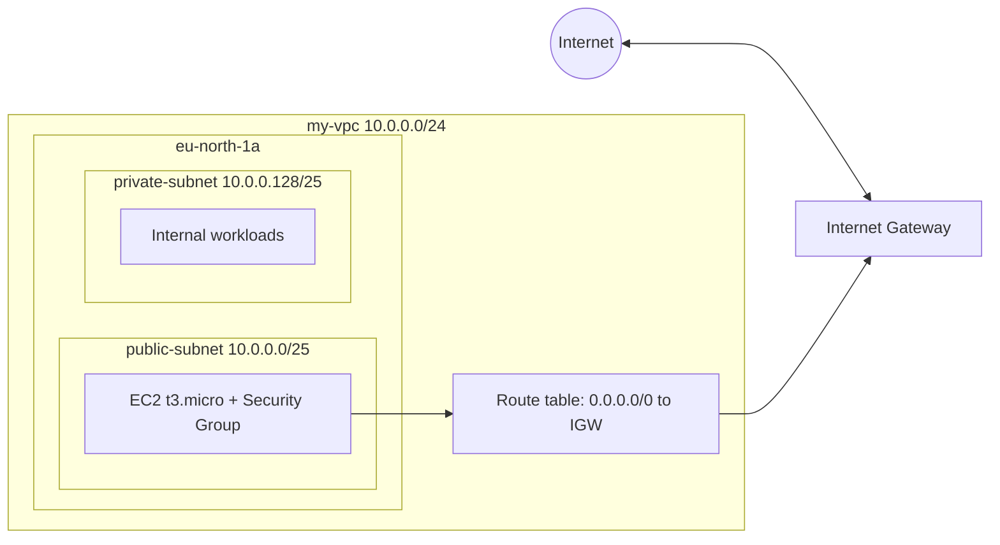

# vpc_connection
# Designing a High Availability VPC Architecture on AWS

A step-by-step project that builds a custom **Amazon VPC** with public and private subnets, an Internet Gateway, a route table and an EC2 instance, then verifies internet connectivity with `ping`.

- **Interactive visualisation:** https://bharathibalu19.github.io/vpc-visuallization/
- **Full visual guide (PDF):** [docs/VPC_Project_Visual_Guide_Bharathi_B.pdf](docs/VPC_Project_Visual_Guide_Bharathi_B.pdf)
- **Author:** Bharathi B - [LinkedIn](https://www.linkedin.com/in/bharathib19/)



## Architecture



## IP address plan

| Resource | CIDR | Total IPs | Usable* |
|---|---|---|---|
| VPC `my-vpc` | 10.0.0.0/24 | 256 | - |
| `public-subnet` | 10.0.0.0/25 | 128 | 123 |
| `private-subnet` | 10.0.0.128/25 | 128 | 123 |

\*AWS reserves 5 addresses in every subnet.

## Prerequisites

- An active AWS account
- Basic knowledge of AWS networking (CIDR, subnets, routing)
- Familiarity with the AWS Management Console

## Steps

### 1. Create the VPC
VPC dashboard > **Create VPC** > **VPC only** > Name `my-vpc`, IPv4 CIDR `10.0.0.0/24` > **Create VPC**.

### 2. Create the subnets
VPC dashboard > **Subnets** > **Create subnet**, select `my-vpc`:

| Name | Availability Zone | CIDR |
|---|---|---|
| `public-subnet` | eu-north-1a | 10.0.0.0/25 |
| `private-subnet` | eu-north-1a | 10.0.0.128/25 |

### 3. Set up the Internet Gateway
**Internet gateways** > **Create internet gateway** (name `IGW`) > **Actions > Attach to VPC** > select `my-vpc`. Confirm the state is **Attached**.

### 4. Configure the route table
1. **Route tables** > **Create route table**: name `rt`, VPC `my-vpc`.
2. **Subnet associations** > associate **`public-subnet`** with `rt`.
3. **Routes** > **Edit routes** > add destination `0.0.0.0/0`, target `IGW` > **Save changes**.

> **Keep the private subnet private:** any subnet associated with a table that has a `0.0.0.0/0` route to the IGW is a public subnet. Leave `private-subnet` on the Main route table (local route only).

### 5. Launch an EC2 instance
| Setting | Value |
|---|---|
| Name | `ec2-for-vpc` |
| AMI | Amazon Linux 2023 |
| Instance type | t3.micro (free tier eligible) |
| Key pair | create new or choose existing |
| VPC / Subnet | `my-vpc` / `public-subnet` |
| Auto-assign public IP | Enable |
| Security group | New, SSH (22) - restrict the source to **My IP** where possible |

### 6. Test connectivity
Wait for **3/3 status checks**, select the instance > **Connect** > **EC2 Instance Connect** (user `ec2-user`), then run:

```bash
ping 8.8.8.8
```

Replies from `8.8.8.8` with 0% packet loss confirm the instance reaches the internet through the Internet Gateway.

## Clean-up

1. **Terminate** the EC2 instance.
2. **Delete the VPC** (Actions > Delete VPC, type `delete`). This also removes the IGW, route table, security group and both subnets.

## Making it truly highly available

This lab uses one Availability Zone for simplicity. To go further:

- Mirror the public and private subnets in a second AZ (for example `eu-north-1b`) and use a larger VPC CIDR to fit them
- Add a **NAT Gateway** for outbound-only access from private subnets
- Place instances behind an **Application Load Balancer** with **Auto Scaling**
- Enable **VPC Flow Logs** for monitoring

## Repository structure

```
vpc-project/
├── README.md
├── docs/
│   └── VPC_Project_Visual_Guide_Bharathi_B.pdf
└── images/
    └── architecture.png
```

## Author

**Bharathi B** - [LinkedIn](https://www.linkedin.com/in/bharathib19/) | [GitHub Pages visualisation](https://bharathibalu19.github.io/vpc-visuallization/)
